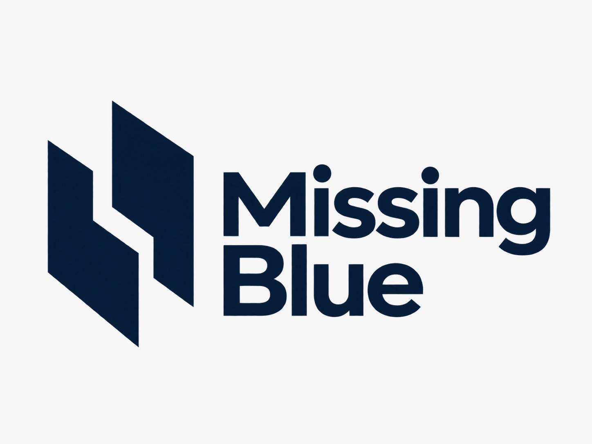
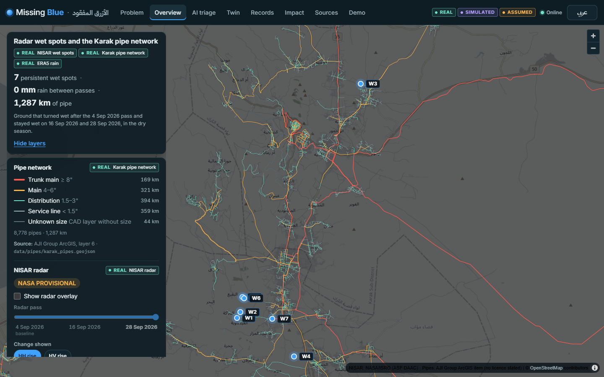
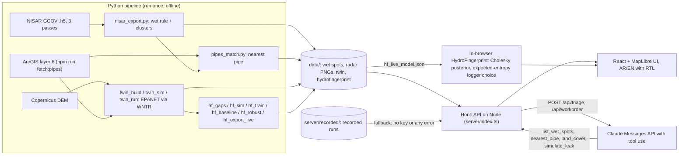

# Missing Blue · الأزرق المفقود

Free NASA–ISRO **NISAR** L-band radar finds ground in Karak (Jordan) that turned wet and stayed wet through the dry season. We check every wet spot against the utility's **real pipe network**, an AI agent decides where the crew goes, a hydraulic twin shows why pressure loggers miss these leaks, and the AI writes a bilingual (Arabic/English) work order.

AI Quest 2026 (HTU, Amman) · AI App Hackathon · Sector 2 next.society() · water and resources: leak detection.



*Overview screen: the real Karak pipe network coloured by class, the 7 NISAR wet spots and the radar controls. Every layer carries a provenance badge.*

## New: sidebar console, AI council, Ask Missing Blue, adaptive learning

- **Sidebar console:** every desktop screen now sits in one shell (navy sidebar with Operations / Data & evidence / Links, workspace card «مكتب فاقد المياه · الكرك», data date and language toggle). `#/sites` is the main map: real radar and real pipes with a side panel of tabs (Sites, Field reports, Map edits, Log) and a site card (inspect-first button, before/after radar slider, stats, trend chart with dashed threshold). Wet spots stay *candidates*, never confirmed leaks; positions are ±50 m.
- **Multi-agent AI council (`#/council`, `POST /api/council`):** three specialists (radar, network, land use) work in parallel with their own data tools, a skeptic argues against every dispatch, and a dispatcher decides. Every number is checked against tool results. Offline or without a key it replays a real recorded live run, labelled "Recorded run".
- **Ask Missing Blue (`#/assistant`, `POST /api/assistant`):** ask questions about spots, pipes and loggers; Claude answers only through read-only tools over `data/`, and the numbers are checked. Recorded answers are the offline fallback, labelled "Recorded run".
- **Adaptive learning (`#/learning`, `/api/learning`):** crew outcomes nudge the dispatch weights and re-rank where to send a crew next. **No real field outcome exists yet:** every label is a demo label typed into this demo, and the screen says so. Reset returns to the dispatch rule. Writes are logged (`/api/audit`).

---

## Quick start

Needs **Node 20+** (tested on Node 22). No Python is needed to run the app.

```bash
git clone https://github.com/kurdim12/missing-blue.git
cd missing-blue
npm install
cp .env.example .env          # optional: put ANTHROPIC_API_KEY in it for live AI (without it: recorded runs)
npm run fetch:pipes           # downloads the Karak pipe network (ArcGIS layer 6 only) into data/pipes/ (not in git)
npm run dev                   # web on http://localhost:5173 (API on :8787, proxied)
```

Open **http://localhost:5173**. Start at `#/problem`, or press **Demo** in the top bar for the guided 7-minute path (arrow keys, PageDown or Space to move on).

One-command demo build (what we present from; the API also serves the built app):

```bash
npm run demo                  # vite build, then the Hono server on http://localhost:8787
```

On Windows `cmd`, use `copy .env.example .env`. Other scripts: `npm run typecheck`, `npm run build`, `npm run start` (serves an existing `dist/`).

### Works without an API key

The two Claude screens (AI triage and the work order) call the Claude API only when `ANTHROPIC_API_KEY` is set. Without a key, or on **any** error (no Wi-Fi, auth, timeout, bad output), the server plays a **recorded run** from `server/recorded/` and the UI tags it **RECORDED RUN** with the reason. In a recorded triage run the tool calls are re-executed against `data/` on every replay, so every tool result on screen comes from the data files; only the decisions are the recording. Token counts are shown only for live runs, never invented.

### Works offline

Everything is local except the online map tiles (satellite imagery, the OpenStreetMap "Map" style and the optional 3D terrain) and live Claude calls. With Wi-Fi off, or after repeated tile errors, the map falls back to a plain dark background (pipes, spots and radar overlays are local data), the AI screens show recorded runs, and the HydroFingerprint model runs in the browser.

### Basemap: satellite by default

- **Satellite (default):** Esri World Imagery in natural colour, with Esri's roads and place-name overlays on top of the photo and below every data layer. The credit "Esri, Vantor, Earthstar Geographics, and the GIS User Community" is on the map whenever satellite is on.
- **Map:** the earlier dimmed dark OpenStreetMap style, one click away on the **Satellite | Map** switch («قمر صناعي» | «خريطة»). The choice is remembered in this browser.
- **3D (optional):** relief from AWS Terrain Tiles on the large desktop maps (Overview, Sites, Twin). Off by default; if the terrain tiles fail it switches off. Relief is visual only: the twin's elevations come from Copernicus DEM.
- **What the photo is and is not:** REAL imagery, for orientation. It shows the ground, **not leaks**, and it is not from the radar dates: Esri's metadata (checked 10 Oct 2026) gives a WorldView-2 image of **27 May 2020** at W7, W3 and Karak Castle, while the radar passes are 4 / 16 / 28 Sep 2026.
- **Terms:** Esri basemaps are used under the Esri Master License Agreement with attribution, for this non-commercial hackathon demo, and are never cached for offline use. Details and links: [SOURCES.md](SOURCES.md#basemap-and-3d-terrain-checked-10-oct-2026).

### What is held back from git (and what a fresh clone shows)

| Path | Why it is not in the public repo | How to get it / what you see without it |
|---|---|---|
| `data/pipes/*` | The Karak network is critical infrastructure, published on ArcGIS with **no licence stated**. We do not redistribute it. | `npm run fetch:pipes` downloads it from the owner's public FeatureServer (layer 6 only; **never layer 2**, the customers layer with personal data). Without it, map screens still show the spots and the radar and say "run npm run fetch:pipes". |
| `data/twin/*` (`mazar_zone.inp`, `mazar_zone_results.json`) | Contains Mazar-zone pipe coordinates (derived from the pipe network). Held back until the owner confirms it may be public. | Rebuilt by `pipeline/twin_build.py` → `twin_sim.py` → `twin_run.py` (Python; needs the pipes and the DEM). Without it, the Twin screen explains that the model file is held back because it contains pipe coordinates. |
| `data/hydrofingerprint/hf_live_model.json`, `hydrofingerprint_results.json`, `hf_gaps_pick.json` | Contain gap and logger coordinates on the same pipe network. | Rebuilt by `pipeline/hf_*.py`. Without them, the Records screen shows the held-back message; its "Why AI and not a plain algorithm?" panel still renders from the two committed files (`hydrofingerprint_robustness.json`, `hydrofingerprint_scale9.json`). |
| `data/radar/*.tif`, `data/elevation/*.tif`, `data/hydrofingerprint/*.npz` | Large rasters and training sets. | The app uses the committed PNG overlays in `public/radar/` (made by `scripts/convert_radar.py`). |
| `demo/missing-blue.html` | Single-file prototype that embeds the same twin geometry. | Not needed: its logic and wording were ported into this app. |
| `.env` | Your API key. | `cp .env.example .env`. |

Every screen renders an honest Arabic/English message when one of these files is missing; nothing crashes.

Note on `hydrofingerprint_scale9.json`: until the commit that added this note, its `sensors` list carried the latitude/longitude of the 15 logger junctions it uses (Mazar network). The current file keeps node ids only, but those 15 coordinates remain in the public git history. Removing them from history needs a history rewrite and a force push, which is the repository owner's decision.

---

## Screens

| Route | Screen | Journey / criterion |
|---|---|---|
| `#/problem` | The problem: 41% non-revenue water (Petra, Aug 2026), who is left out, who benefits | Impact |
| `#/overview` | Real pipes by class, 7 wet spots, radar overlay with the 4 / 16 / 28 Sep 2026 slider, header facts computed from the files | Journey 1 · steps 2–3 |
| `#/triage` | "Triage with AI": Claude with the tools `list_wet_spots`, `nearest_pipe`, `land_cover`, `simulate_leak`; streamed tool log; every number in a reason checked against the tool results | Journey 1 · step 4 · Innovation |
| `#/spot/W7` | Spot detail: radar rise, nearest pipe (size, material, distance, position ±50 m), land cover 2023–2025, Google Maps link | Journey 1 · step 5 |
| `#/twin` | Hydraulic twin of the Mazar zone: normal day / leak at W7 1 L/s / main break 15 L/s | Journey 1 · step 6 |
| `#/records` | HydroFingerprint: which gaps in the pipe drawing are real connections. Live in-browser model, AI logger placement, 24 hidden test networks with "Reveal the truth", "Why AI and not a plain algorithm?" | Journey 3 · Innovation, Technical |
| `#/workorder/W7` | Bilingual work order written by Claude from a facts JSON (numbers checked), printable, QR code that opens the crew view on a phone | Journey 1 · step 7 |
| `#/crew/W7` | Crew phone view, Arabic first: pin with the ±50 m circle, Google Maps, checklist, "Leak found / No leak" (stored in the browser) | Journey 2 · UX |
| `#/impact` | Impact and business: data cost, one hidden leak, crew effort, running cost, who pays (PLAN), next step | Feasibility |
| `#/sources` | Every dataset with link and licence, the assumptions, the limits | Technical honesty |
| `#/demo` | Guided pitch path in the order of `PITCH_7MIN.md`, keyboard-driven, with a 7:00 clock | Presentation |

Arabic/English toggle in the top bar, with full right-to-left layout everywhere. Checked at 1440×900 and 390×844.

---

## What is REAL, SIMULATED, ASSUMED

Every layer and every result on screen carries one of these badges.

| Badge | What it covers |
|---|---|
| **REAL** | NISAR radar (NASA/ISRO, provisional), the Karak pipe network (ArcGIS layer 6), Copernicus DEM elevation, ERA5 rain (Open-Meteo), Sentinel-2 land cover, the gaps in the pipe drawing, the satellite basemap (Esri World Imagery: captured on other dates than the radar, shows the ground, not leaks) |
| **SIMULATED** | Pressure readings in HydroFingerprint (EPANET simulations of the real network; there is no public logger data for Karak) |
| **ASSUMED** | Hydraulic twin demand (0.7 L/s per km of pipe), supply level (25 m above the highest junction), pipe roughness, leak sizes (1 / 5 / 15 L/s) |
| **RECORDED RUN** | An AI run played back from `server/recorded/` because a live Claude call was not possible |
| **PLAN** | Our business plan (who pays, pilot), not a signed agreement |

Wet spots are **inspection candidates, never confirmed leaks**. Radar position accuracy is about **±50 m** (20 m pixels, 100 m averaging), so the app always says "spot centre X m from the pipe, position ±50 m".

---

## Data sources and licences

| Dataset / claim | Source | Licence / status |
|---|---|---|
| NISAR L2 GCOV radar, track 151 frame 73, passes 4 / 16 / 28 Sep 2026 | [ASF notice](https://asf.alaska.edu/notices/nisar-l-band-data-now-publicly-available/) · [ASF search](https://search.asf.alaska.edu) | NASA open data, marked PROVISIONAL |
| Karak water network (layer 6, 8,779 records, 8,778 with geometry) | [ArcGIS item 7f8adf3ae966453f8cec976d9c35ef48](https://www.arcgis.com/home/item.html?id=7f8adf3ae966453f8cec976d9c35ef48) | Public, **no licence stated**; publisher "AJI Group" unconfirmed. Demo use only, not redistributed |
| Copernicus DEM GLO-30 | [AWS Open Data registry](https://registry.opendata.aws/copernicus-dem/) | Copernicus DEM licence, © DLR/Airbus provided under COPERNICUS |
| Rain 15 Aug–30 Sep 2026 (0.0 mm between passes) | [Open-Meteo historical weather API (ERA5)](https://open-meteo.com/en/docs/historical-weather-api) | CC BY 4.0 |
| Land cover at the spots, 2023–2025 | [Sentinel-2 10 m Land Use/Land Cover](https://ic.imagery1.arcgis.com/arcgis/rest/services/Sentinel2_10m_LandCover/ImageServer) | Impact Observatory / Microsoft / Esri, Living Atlas terms |
| Jordan non-revenue water 41% (Aug 2026), target 25% by 2040 | [Petra news agency](https://www.petra.gov.jo/en/news/water-loss-cut-to-41-exceeding-target) | Cited |
| Government AI leak project (Smart Transformation, sensor data) | [MENA Startup Digest](https://menastartupdigest.com/?p=47589) | Context |
| NISAR L-band 24 cm; 12-day repeat | [NASA](https://science.nasa.gov/mission/nisar/) · [JPL](https://www.jpl.nasa.gov/press-kits/nisar/mission-overview) | Cited |
| EPANET (public domain), WNTR (EPA/Sandia) | [EPANET](https://www.epa.gov/water-research/epanet) · [WNTR](https://github.com/USEPA/WNTR) | Used offline to build the twin and the simulations |
| Satellite basemap (default): Esri World Imagery | [ArcGIS item](https://www.arcgis.com/home/item.html?id=10df2279f9684e4a9f6a7f08febac2a9) · tiles `https://server.arcgisonline.com/ArcGIS/rest/services/World_Imagery/MapServer/tile/{z}/{y}/{x}` | Esri Master License Agreement; attribution "Esri, Vantor, Earthstar Geographics, and the GIS User Community"; non-commercial hackathon demo; online only, not cached. Capture date is not the radar date (27 May 2020 at W7, W3 and Karak Castle per Esri metadata, checked 10 Oct 2026) |
| Basemap labels: Esri World Transportation + World Boundaries and Places | [Roads item](https://www.arcgis.com/home/item.html?id=94f838a535334cf1aa061846514b77c7) · [Places item](https://www.arcgis.com/home/item.html?id=a842e359856a4365b1ddf8cc34fde079) | Esri Master License Agreement; attribution "Esri, HERE, Garmin, © OpenStreetMap contributors, and the GIS User Community"; online only |
| Optional 3D terrain: AWS Terrain Tiles (Terrarium) | [AWS Open Data registry](https://registry.opendata.aws/terrain-tiles/) · tiles `https://s3.amazonaws.com/elevation-tiles-prod/terrarium/{z}/{x}/{y}.png` | Open data (Mapzen); attribution required for its sources ([list](https://github.com/tilezen/joerd/blob/master/docs/attribution.md)), e.g. SRTM and GMTED2010 (USGS), ETOPO1 (NOAA); online only |
| "Map" basemap | © OpenStreetMap contributors | ODbL (online only) |

Full list: [SOURCES.md](SOURCES.md). Data dictionary and verified facts: [CLAUDE.md](CLAUDE.md).

---

## Architecture



- **Frontend:** Vite 7, React 18, TypeScript, MapLibre GL 5 (Esri satellite basemap with road and place labels by default, OSM "Map" style on a switch, optional 3D terrain on the desktop maps; plain dark background offline), self-hosted Inter and IBM Plex Sans Arabic.
- **Backend:** Hono on Node (`server/index.ts`, run with `tsx`). Typed JSON routes over `data/`; raw `data/` files are never served directly.
- **AI agents:** `server/council.ts` (three specialists, skeptic, dispatcher; server-sent events), `server/assistant.ts` (tool-using Q&A), `server/learning.ts` (demo-label weight updates), `server/audit.ts` (write log); live Claude with a recorded fallback in `server/recorded/`.
- **AI:** Claude Messages API with tool use (`@anthropic-ai/sdk`) for triage and work orders. Facts are passed as JSON, and every number in the model's text is checked against the tool results. HydroFingerprint inference runs in the browser.

API: `GET /api/spots`, `GET /api/spots/:id`, `GET /api/pipes?bbox=`, `GET /api/pipes/summary`, `POST /api/triage` (server-sent events), `POST /api/workorder`, `GET /api/twin/mazar?scenario=base|svc1|m5|m15|far15`, `GET /api/hf/model`, `GET /api/hf/results`, `GET /api/health`.

---

## AI methods and results

What the AI is: a **physics-guided Bayesian model** and a **neural network (MLP)** trained on EPANET simulations of a real Jordanian network, **information-gain placement** of pressure loggers, and a **Claude agent** with tool use. It is not a graph neural network (that is the scale-up path for many networks).

| Method | What it does | Where |
|---|---|---|
| Radar change detection | A pixel is wet if HH ≥ +2 dB and HV ≥ +1.5 dB vs 4 Sep at **both** later passes; clusters ≥ 4 pixels; checked against ERA5 rain (0.0 mm) and Sentinel-2 land cover | `pipeline/nisar_export.py` → 7 wet spots |
| Claude triage agent | Calls 4 tools over `data/`; dispatches only within 40 m of a real pipe; rejects farmland far from pipes | `server/triage.ts` |
| Claude work order | Arabic and English text from a facts JSON; numbers copied exactly and checked | `server/workorder.ts` |
| HydroFingerprint (Bayesian + MLP) | P(gap is a real connection) for 5 gaps from simulated pressure readings; says "can't tell yet" when the physics cannot decide | `pipeline/hf_*.py`, `src/features/hf/engine.ts` |
| Active sensing | Greedy information-gain placement of pressure loggers | `pipeline/hf_train.py`; in the browser: expected-entropy choice |

**Results** (from `data/wet_spots/`, `data/twin/mazar_zone_results.json` and `data/hydrofingerprint/*.json`):

| Result | Value | File |
|---|---|---|
| Wet spots within 40 m of a real pipe | 2 of 7. W7: spot centre 6 m from a ¾" galvanized iron service line, built area 2023–2025. W3: 38 m from a 1" line on open rangeland | `wet_spots.geojson` |
| Twin, leak of 1 L/s at W7: junctions dropping > 1 m | 1 other junction (2 including the leak junction) of 850 | `mazar_zone_results.json` |
| Twin, 15 L/s break on a 4" main about 1.9 km from W7: junctions dropping > 1 m | 788 of 850 | `mazar_zone_results.json` |
| Information from 10 loggers: AI-placed vs random | 3.63 vs 1.71 bits (of 5) | `hydrofingerprint_results.json` |
| Gap accuracy A–E, 3 spread loggers (Bayesian) | 52.6 / 52.5 / 50.3 / 52.5 / 49.5% (chance) | `hydrofingerprint_results.json` |
| Gap accuracy A–E, 10 loggers (Bayesian) | 100 / 93.1 / 99.4 / 99.7 / 49.3%; all 5 right 46.1% (MLP 37.2%) (training run in `hydrofingerprint_results.json`; the screens quote the separate evaluation in `hydrofingerprint_robustness.json`, 46.9%, next row) | `hydrofingerprint_results.json` |
| AI vs plain least-squares algorithm, same 10 loggers, all 5 right | **46.9% vs 26.7%** (1,440 test cases) | `hydrofingerprint_robustness.json` |
| Same, on a network that does not match the model (roughness ×0.8–1.2, demand ×0.5–1.6, tank ±5 m, more noise) | **45.4% vs 23.9%** (800 cases) | `hydrofingerprint_robustness.json` |
| Calibration: when it says ≥ 90% or ≤ 10% (about 70% of decisions) | right 99.9% (nominal) / 99.1% (mismatched network) | `hydrofingerprint_robustness.json` |
| Scale: 9 gaps (512 states), 15 loggers, all 9 right | MLP 19.8%, Bayesian 17.8%, plain algorithm 3.9%, chance 0.2% | `hydrofingerprint_scale9.json` |

Gap E (G6) cannot be resolved by pressure: the system says "can't tell yet" and sends a crew to check the valve chamber instead of guessing. The plain algorithm needs one reference simulation per network state (2^K): 512 for 9 gaps, about a million for 20.

---

## Limits (we say them before the judges do)

- Wet spots are **candidates**, not confirmed leaks; a crew confirms with an acoustic detector. A garden next to a pipe can pass the filter.
- Radar position is about **±50 m**, and NASA marks the NISAR products **provisional**.
- The pipe record is from 2020 (CAD file saved 2022); newer pipes are missing. The publisher's identity is unconfirmed and no licence is stated.
- Twin demand, supply level and leak sizes are **assumed**; geometry and elevation are real. A single pressure zone is assumed (no PRVs), so some modelled pressures are unrealistically high.
- HydroFingerprint readings are **simulated**: this proves the method under known truth; it does not prove which Karak gaps are connected.
- The crew view stores "Leak found / No leak" in the browser only (no backend for field reports yet).
- How many Jordanian networks lack sensor data is **to confirm with the utility**; we do not state a count.

---

## Repository map

```
server/            Hono API (index.ts), data access (data.ts), Claude triage + work order, recorded runs
src/               React app: screens/, features/<screen>/, map/, ui/, shell/, i18n.tsx (AR/EN)
public/radar/      NISAR PNG overlays + bounds.json (committed; the TIFs are not)
data/              wet_spots and HydroFingerprint robustness/scale9 (committed); pipes, twin and live model held back
pipeline/          Python scripts that produced data/ (radar, pipe matching, twin, HydroFingerprint)
scripts/           fetch_pipes.ts (layer 6 only), convert_radar.py
docs/              CONVENTIONS.md (how the screens plug in), img/
CLAUDE.md          data dictionary, verified facts, honesty rules
PITCH_7MIN.md      the 7-minute script that Demo mode follows
USER_JOURNEY.md    the four user journeys
SOURCES.md         the source for every number
```

## Team

Team: (to fill)
