<div align="center">


# Missing Blue · الأزرق المفقود

**Free NASA–ISRO radar finds ground in Karak that stays wet in the dry season. We check every wet spot against the utility's real pipe network, and AI decides where the leak crew goes first.**

<a href="docs/media/missing-blue-film.mp4">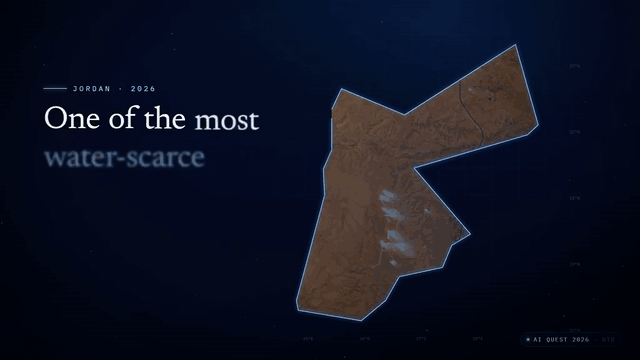</a>

**🌐 [Live demo](https://pct-adjacent-williams-isolation.trycloudflare.com)** · **▶ [Watch the full pitch film (97 s, MP4)](docs/media/missing-blue-film.mp4)**<br>
<sub>The live demo runs from the team laptop during AI Quest 2026 (AI screens play recorded runs). Pitch film for AI Quest 2026. Its figures belong to the film's story; this repo's own numbers are in the table below.</sub>


[Quick start](#quick-start) · [How it works](#how-it-works) · [Screens](#what-you-can-do) · [Data and honesty](#data-and-honesty) · [Architecture](#architecture) · [FAQ](#faq-and-troubleshooting) · [Sources](#sources-licences-and-credits)

</div>

---

| | |
|---|---|
| **Problem** | 41% of the water Jordan pumps is non-revenue water (Petra news agency, Aug 2026). Most leaks never reach the surface, and the government's AI leak project works from sensor data: a town without sensors gets nothing from it. |
| **Input** | 3 passes of NISAR L-band radar over Karak (4 / 16 / 28 Sep 2026, 0.0 mm rain between them) and the utility's own pipe drawing (8,778 pipes, 1,287 km). |
| **Output** | 7 wet spots. 2 lie within 40 m of a real pipe (W7: spot centre 6 m from a ¾" galvanized iron service line; W3: 38 m from a 1" line) and get a crew; 5 farmland spots are rejected. Then a bilingual work order and an Arabic-first crew phone view. |
| **Honesty** | Every layer carries a badge: REAL, SIMULATED, ASSUMED, RECORDED RUN, PLAN or DEMO LABEL. Wet spots are **candidates, never confirmed leaks**, and positions are **±50 m**. |

AI Quest 2026 (HTU, Amman) · AI App Hackathon · Sector 2 next.society() · water and resources: leak detection.

## Screenshots

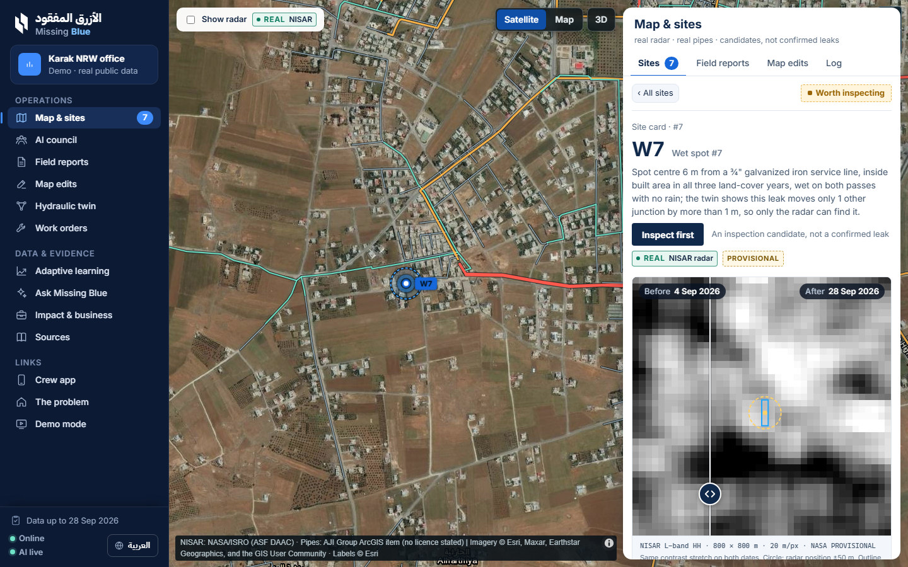

*Map & sites (`#/sites`), the main map. Wet spot W7 on the satellite basemap with the pipes coloured by class. The site card reads "Spot centre 6 m from a ¾" galvanized iron service line", the **Inspect first** button says "An inspection candidate, not a confirmed leak", and the before/after slider compares the radar on 4 Sep and 28 Sep 2026 (REAL NISAR radar, PROVISIONAL).*

<table>
  <tr>
    <td width="50%" valign="top">
      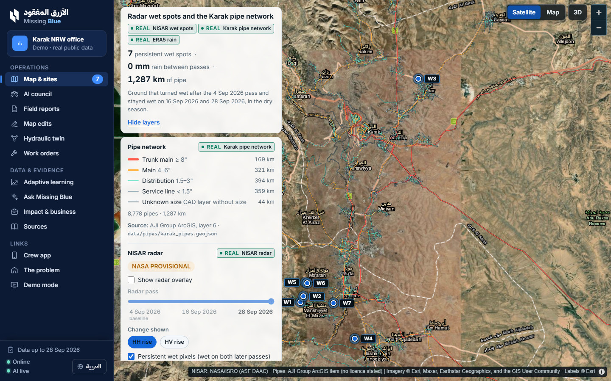<br>
      <sub><b>Overview.</b> All 7 wet spots (W1–W7) over Karak. The pipe legend gives km by class, there is a radar pass slider for 4 / 16 / 28 Sep 2026, and REAL badges sit next to the NASA PROVISIONAL tag.</sub>
    </td>
    <td width="50%" valign="top">
      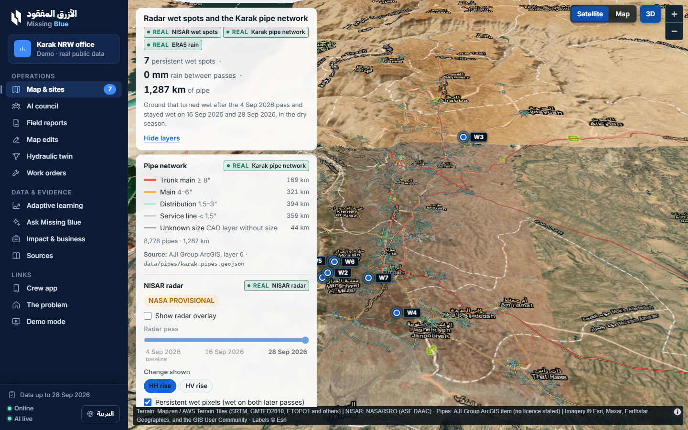<br>
      <sub><b>Optional 3D.</b> The same overview tilted over terrain relief, with Mapzen / AWS Terrain Tiles credited in the map footer.</sub>
    </td>
  </tr>
  <tr>
    <td width="50%" valign="top">
      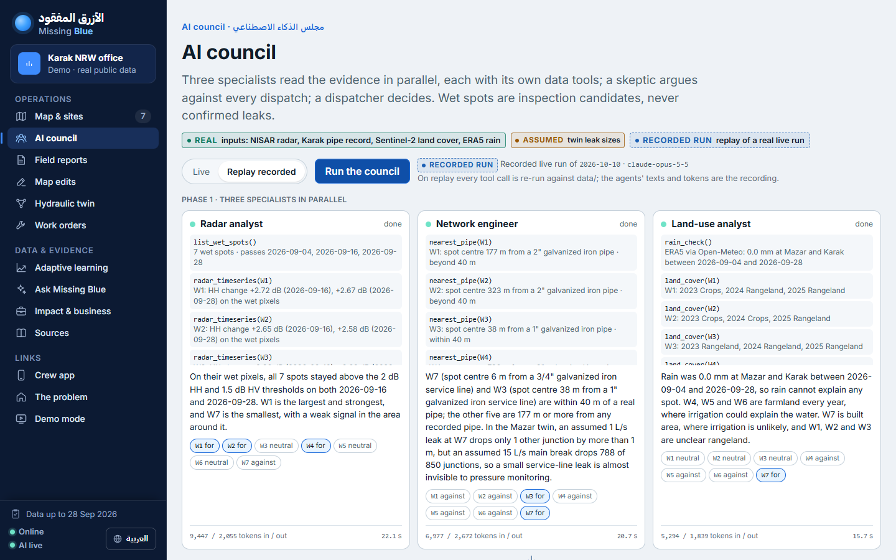<br>
      <sub><b>AI council.</b> A replay of a recorded live run (RECORDED RUN badge). The radar analyst, network engineer and land-use analyst run in parallel, and each shows its tool calls, a for/against signal per spot and its token counts.</sub>
    </td>
    <td width="50%" valign="top">
      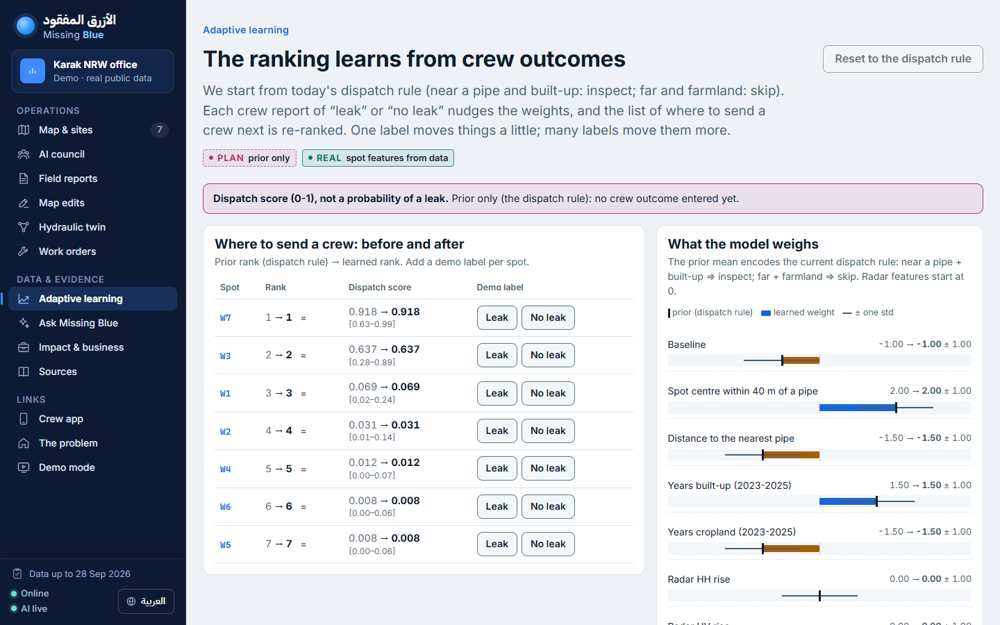<br>
      <sub><b>Adaptive learning.</b> A "Dispatch score (0-1), not a probability of a leak" banner, the before/after rank per spot, Leak / No leak demo-label buttons, and the model weights shown against the dispatch-rule prior.</sub>
    </td>
  </tr>
  <tr>
    <td width="50%" valign="top">
      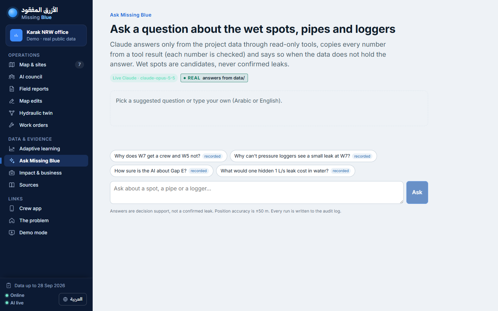<br>
      <sub><b>Ask Missing Blue.</b> Four suggested questions, each with a recorded answer, plus free text in Arabic or English. A "REAL answers from data/" badge sits under the title.</sub>
    </td>
    <td width="50%" valign="top">
      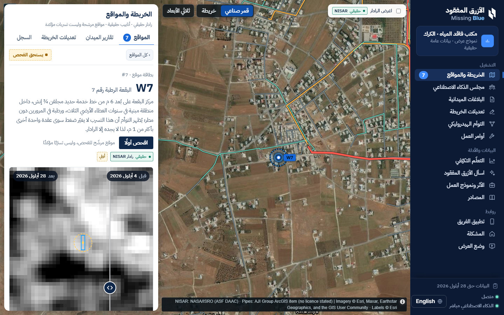<br>
      <sub><b>Arabic.</b> The same W7 site card in Arabic. The layout is fully right to left, with the sidebar on the right.</sub>
    </td>
  </tr>
  <tr>
    <td colspan="2" align="center">
      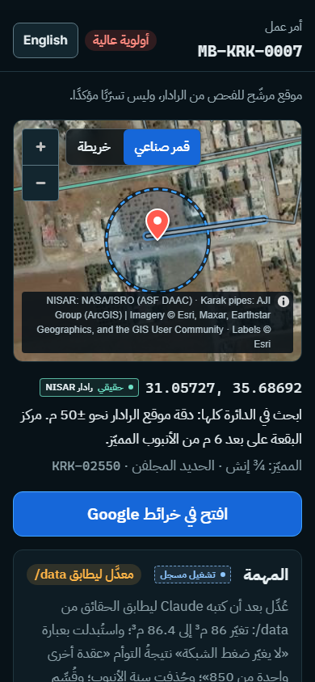<br>
      <sub><b>Crew phone view (390 px, Arabic).</b> Order MB-KRK-0007 at high priority, with a satellite pin inside the ±50 m search circle, the coordinates, and an "Open in Google Maps" button.</sub>
    </td>
  </tr>
</table>

---

## Quick start

**You need:** [Node.js](https://nodejs.org) **20.12 or newer** (`package.json` asks for `>=20`; the server reads `.env` with `process.loadEnvFile`, which arrived in Node 20.12; tested on Node 22) and git. **You do not need Python** to run the app. It is used only by the optional `npm run convert:radar` (numpy, Pillow, tifffile), which rebuilds the radar PNGs from GeoTIFFs that are not in the repo. Those PNGs are already committed.

**1. Clone**

```bash
git clone https://github.com/kurdim12/missing-blue.git
```

**2. Enter the folder**

```bash
cd missing-blue
```

**3. Install**

```bash
npm install
```

**4. (Optional) Live AI key**

```bash
cp .env.example .env
```

Then open `.env` and set `ANTHROPIC_API_KEY=` to your own key (never commit it; `.env` is gitignored). You can **skip this step**: without a key every AI screen plays a recorded run, labelled "Recorded run". `CLAUDE_MODEL` defaults to `claude-opus-5-5` and `PORT` to `8787`. On Windows `cmd`, use `copy .env.example .env`.

**5. (Recommended) Download the pipe network**

```bash
npm run fetch:pipes
```

This downloads the Karak water network from its owner's public ArcGIS FeatureServer, **layer 6 only** (never layer 2, the customers layer with personal data), into `data/pipes/karak_pipes.geojson`. That folder is not in git. Without it, the map screens still show the wet spots and the radar and tell you to run `npm run fetch:pipes`.

**6. Build and start**

```bash
npm run demo
```

**7. Open <http://localhost:8787>**

The app opens on `#/problem`. Use the sidebar to move between screens.

> [!TIP]
> **Demo mode in one click:** open <http://localhost:8787/#/demo> or click **Demo mode** in the sidebar. It walks through the 12 steps of [`PITCH_7MIN.md`](PITCH_7MIN.md) with a 7:00 presenter clock:
> - Next: <kbd>→</kbd>, <kbd>PageDown</kbd> or <kbd>Space</kbd>
> - Back: <kbd>←</kbd>, <kbd>PageUp</kbd> or <kbd>Shift</kbd>+<kbd>Space</kbd>
> - First / last step: <kbd>Home</kbd> / <kbd>End</kbd>
> - Show or hide the presenter cue: <kbd>C</kbd>
>
> The council step replays the recorded run at once. Opening Demo mode, or going back to step 1, clears the demo crew reports in this browser.

<details>
<summary><b>Other ways to run it, and every script</b></summary>

| Command | What it does |
|---|---|
| `npm run demo` | `vite build`, then the Hono server on `http://localhost:8787`, which serves both the API and the built app. **This is what we present from.** |
| `npm run dev` | Development: the web app on `http://localhost:5173` (proxies `/api`) and the API on `:8787` with reload. |
| `npm run start` | Starts the server only and serves an existing `dist/`. |
| `npm run build` | Type-checks (`tsc --noEmit`), then `vite build`. |
| `npm run typecheck` | `tsc --noEmit`. |
| `npm run fetch:pipes` | Downloads ArcGIS layer 6 into `data/pipes/` (see step 5). |
| `npm run convert:radar` | Python: `data/radar/*.tif` → `public/radar/*.png`. Optional: the PNGs are committed and the TIFs are not. |

Environment variables (all optional):

| Variable | Default | Effect |
|---|---|---|
| `ANTHROPIC_API_KEY` | none | Turns on live Claude calls. Without it, the AI screens play recorded runs. |
| `CLAUDE_MODEL` | `claude-opus-5-5` | Model for the live calls. |
| `PORT` | `8787` | Server port. The Vite dev proxy reads it from the shell environment, not from `.env`. |
| `ANTHROPIC_WORKSPACE_ID` | none | Sends the `anthropic-workspace-id` header, which a key scoped to a workspace needs (`server/claude.ts`). |
| `ASSISTANT_EFFORT` | `low` | Set it to `medium` for deeper assistant answers. |
| `COUNCIL_RECORD` | none | `1` makes a successful live council run overwrite `server/recorded/council.json`. |
| `DIST` | `dist` | The folder of the built app that the server serves. |

To re-run the Python data pipeline (optional, Python 3.10+), install `pip install h5py numpy scipy pyproj pillow rasterio shapely networkx wntr`. See "Re-running the pipeline" in [`CLAUDE.md`](CLAUDE.md). The scripts take their paths as arguments, so read them before you run them.

</details>

---

## How it works

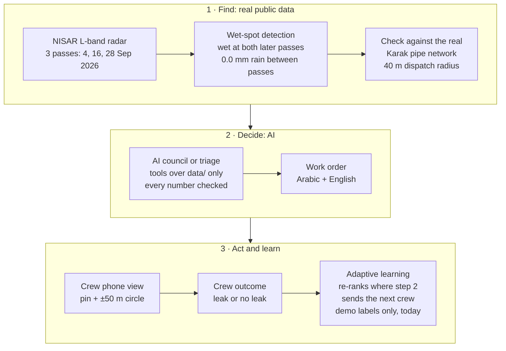

1. **Radar.** A pixel is wet if HH ≥ +2 dB and HV ≥ +1.5 dB compared with 4 Sep, at **both** later passes. Wet pixels are grouped into clusters of at least 4 pixels, and the result is checked against ERA5 rain (0.0 mm) and Sentinel-2 land cover. That gives **7 wet spots** (`pipeline/nisar_export.py`).
2. **Pipes.** Each spot is matched to the nearest real pipe. **2 of 7** are within 40 m: W7 (6 m, built area 2023–2025) and W3 (38 m, open rangeland). W1, W2, W4, W5 and W6 are 177 m to 1.4 km from any pipe, on farmland.
3. **AI.** Claude agents call tools over `data/`. Nothing can be dispatched more than 40 m from a real pipe, and every number in the model's text is checked against the tool results or the facts it was given.
4. **Field.** The crew gets an Arabic-first phone view. Its "Leak found / No leak" is stored on the phone and also sent as a **demo label** to the learning store, which re-ranks where to send a crew next.

<details open>
<summary><b>The multi-agent AI council (<code>#/council</code>, <code>POST /api/council</code>)</b></summary>

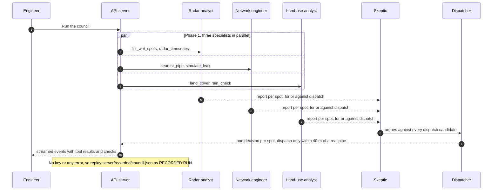

- There are five Claude agents, each a separate call with its own system prompt and tools. Phase 1 runs in parallel (`Promise.all`), then the skeptic (red team), then the dispatcher, who answers the skeptic.
- If an agent writes a number that is not in its tool results or the facts it was given, it is told which numbers are wrong and must rewrite (twice at most). After that the run falls back to the recording.
- A recorded replay re-runs every tool call against `data/`, so every tool result on screen comes from the data files. Only the agents' texts and tokens come from the recording.
- The single-agent **AI triage** (`#/triage`, `POST /api/triage`) uses the same pattern with 4 tools: `list_wet_spots`, `nearest_pipe`, `land_cover` and `simulate_leak`.

</details>

---

## What you can do

The sidebar console has three groups: **Operations**, **Data & evidence** and **Links**. The workspace card reads «مكتب فاقد المياه · الكرك» (Karak NRW office), and the footer holds the latest radar date, the online/AI status and the language toggle. Checked at 1440×900 and 390×844.

| Screen (sidebar) | Route | What it shows | Provenance |
|---|---|---|---|
| **Map & sites** | `#/sites` | The main map: real radar and real pipes, 7 wet spots, and panel tabs (Sites, Field reports, Map edits, Log). The site card has the inspect-first button, a before/after radar slider, stats and a trend chart with a dashed threshold. | `REAL` · `PROVISIONAL` · `RECORDED RUN` · `SIMULATED` (Map edits tab) |
| **AI council** | `#/council` | The three specialists → skeptic → dispatcher, with a live tool log, a signal per spot, each decision and the dissent. Choose Live or Replay recorded. | `REAL` · `ASSUMED` · `RECORDED RUN` |
| **Field reports** | `#/sites?tab=reports` | Crew outcomes entered in this demo. | `DEMO LABEL` |
| **Map edits** | `#/records` | HydroFingerprint: which gaps in the pipe drawing are real connections. Live in-browser model, AI logger placement, 24 hidden test networks with "Reveal the truth", and "Why AI and not a plain algorithm?". | `REAL` gaps · `SIMULATED` readings |
| **Hydraulic twin** | `#/twin` | The Mazar zone in three scenarios: a normal day, a 1 L/s leak at W7, and a 15 L/s main break. | `REAL` geometry · `ASSUMED` operation |
| **Work orders** | `#/workorder/W7` | A bilingual order that Claude writes from a facts JSON, with every number checked. It is printable, and a QR code opens the crew view on a phone. | `REAL` · `ASSUMED` · `RECORDED RUN` |
| **Adaptive learning** | `#/learning` | Crew outcomes nudge the dispatch weights and re-rank the spots. "Reset to the dispatch rule" undoes them, and every write is logged. | `PLAN` prior · `REAL` features · `DEMO LABEL` |
| **Ask Missing Blue** | `#/assistant` | Questions about spots, pipes and loggers, in Arabic or English. Claude answers only through read-only tools over `data/`. | `REAL` · `RECORDED RUN` |
| **Impact & business** | `#/impact` | Data cost, one hidden leak, crew effort, running cost, who pays, and the next step. | `REAL` · `ASSUMED` · `PLAN` · `RECORDED RUN` |
| **Sources** | `#/sources` | Every dataset with its link and licence, plus the assumptions and the limits. | all badges |
| **Crew app** | `#/crew/W7` | Phone layout, Arabic first: a pin with the ±50 m circle, Google Maps, a checklist, and "Leak found / No leak". | `REAL` · `ASSUMED` · `RECORDED RUN` |
| **The problem** | `#/problem` | 41% non-revenue water (Petra, Aug 2026), who is left out and who benefits. | `REAL` · `SIMULATED` · `ASSUMED` |
| **Demo mode** | `#/demo` | The guided 7-minute pitch path, driven from the keyboard. | per step |

<details>
<summary><b>Screens reached from links (not in the sidebar)</b></summary>

| Screen | Route | What it shows |
|---|---|---|
| Overview | `#/overview` | Real pipes by class, the 7 wet spots, and a radar overlay with a 4 / 16 / 28 Sep 2026 slider. The header facts are computed from the files. |
| AI triage | `#/triage` | Single-agent Claude triage with a streamed tool log. Every number in a reason is checked against the tool results. |
| Spot detail | `#/spot/W7` | Radar rise, nearest pipe (size, material, distance, position ±50 m), land cover 2023–2025, and a Google Maps link. |

</details>

**Map controls.** The **Satellite | Map** switch («قمر صناعي» | «خريطة») picks the background. Satellite (Esri World Imagery with roads and place labels) is the default; Map is the dimmed dark OpenStreetMap style. The choice is remembered in this browser. **3D** (AWS Terrain Tiles) is available on the large desktop maps (Overview, Sites, Twin). It is off by default and switches itself off if the terrain tiles fail.

---

## Data and honesty

### Provenance badges

| Badge | What it covers |
|---|---|
| `REAL` | NISAR radar (NASA/ISRO, provisional), the Karak pipe network (ArcGIS layer 6), Copernicus DEM elevation, ERA5 rain (Open-Meteo), Sentinel-2 land cover, the gaps in the pipe drawing, and the satellite basemap. The basemap is Esri World Imagery, captured on other dates than the radar; it shows the ground, not leaks. |
| `SIMULATED` | Pressure readings in HydroFingerprint (EPANET simulations of the real network; there is no public logger data for Karak). |
| `ASSUMED` | Hydraulic twin demand (0.7 L/s per km of pipe), supply level (25 m above the highest junction), pipe roughness, and leak sizes (1 / 5 / 15 L/s). |
| `RECORDED RUN` | An AI run played back from `server/recorded/` because a live Claude call was not possible. The reason is shown. |
| `PLAN` | Our business plan (who pays, pilot), not a signed agreement. The learning prior is the dispatch rule. |
| `DEMO LABEL` | A crew outcome typed into this demo. **No real field outcome exists yet.** |

### Datasets

| Dataset | Source | Provenance | In the repo? |
|---|---|---|---|
| NISAR L2 GCOV radar, track 151, frame 73, 3 passes | ASF DAAC (NASA open data) | `REAL`, PROVISIONAL | PNG overlays in `public/radar/`: **yes**. GeoTIFFs: no |
| 7 wet spots + per-spot radar time series | computed by `pipeline/nisar_export.py`, `scripts/spot_timeseries.py` | `REAL` (computed) | **yes**, in `data/wet_spots/` |
| Karak water network, layer 6 (8,779 records, 8,778 with geometry) | ArcGIS item `7f8adf3ae966453f8cec976d9c35ef48` | `REAL`, **no licence stated** | **no**: run `npm run fetch:pipes` |
| Rain, 15 Aug–30 Sep 2026 | ERA5 via Open-Meteo | `REAL` | **yes**, as the `rain_check` in the wet-spot file |
| Land cover at the spots, 2023–2025 | Sentinel-2 10 m LULC (Impact Observatory / Microsoft / Esri) | `REAL` | **yes**, in the wet-spot file |
| Copernicus DEM GLO-30 | AWS Open Data | `REAL` | no (local raster) |
| Hydraulic twin, Mazar zone (850 junctions, 883 pipes, 63.6 km) | EPANET via WNTR on the real pipes + DEM | `REAL` geometry, `ASSUMED` operation | **no**: held back |
| HydroFingerprint robustness + scale tests | `pipeline/hf_*.py` | `SIMULATED` readings | **yes**: `hydrofingerprint_robustness.json`, `hydrofingerprint_scale9.json` |
| HydroFingerprint live model, results, gap pick | `pipeline/hf_*.py` | `SIMULATED` readings | **no**: held back |
| Recorded AI runs (triage, council, assistant, work orders) | live Claude runs, saved | `RECORDED RUN` | **yes**, in `server/recorded/` |
| Crew outcomes and audit log | entered in the demo | `DEMO LABEL` | no: local only, in `data/learning/` |
| Satellite basemap + labels, 3D terrain, "Map" style | Esri, AWS Terrain Tiles, OpenStreetMap | `REAL`, for orientation | no: online tiles, never cached |

### Honesty rules, in plain words

- **Candidates, not leaks.** A wet spot is an inspection candidate, never a confirmed leak. A crew confirms it with an acoustic detector, and a garden next to a pipe can still pass the filter.
- **±50 m.** The radar uses 20 m pixels with 100 m averaging, so the app always says "spot centre X m from the pipe, position ±50 m" and never claims metre precision.
- **Not a probability.** The learning screen ranks spots by a **dispatch score (0-1), not a probability of a leak**. No percent sign is shown next to it.
- **Demo labels.** Adaptive learning runs on demo labels typed into this demo. **No real field outcome exists yet.**
- **Recorded runs.** Live Claude is used when a key exists. With no key, or on **any** error (no Wi-Fi, auth, timeout, bad output), the server plays a recorded run and tags it "Recorded run" with the reason. Its tool calls are re-run against `data/`, and token counts are never invented.
- **Imagery date ≠ radar date.** The satellite photo is for orientation only and nothing is computed from it. Esri's metadata (checked 10 Oct 2026) gives a WorldView-2 image of **27 May 2020** at W7, W3 and Karak Castle; the radar passes are 4 / 16 / 28 Sep 2026.
- **Simulated and assumed.** HydroFingerprint pressure readings are simulated, and the twin's demand, supply level and leak sizes are assumed. They are labelled that way on screen.
- **No personal data.** The ArcGIS customers layer (layer 2) is never downloaded. The pipe network is never served as a raw file; it goes only through `/api/pipes`.

<details>
<summary><b>What is held back from git, and what a fresh clone shows</b></summary>

| Path | Why it is not in the public repo | How to get it / what you see without it |
|---|---|---|
| `data/pipes/*` | The Karak network is critical infrastructure, published on ArcGIS with **no licence stated**. We do not redistribute it. | `npm run fetch:pipes` downloads it from the owner's public FeatureServer (layer 6 only; **never layer 2**, the customers layer with personal data). Without it, map screens still show the spots and the radar and say "run npm run fetch:pipes". Work orders take the distance from the spot file and say the pipe identity is unavailable. |
| `data/twin/*` (`mazar_zone.inp`, `mazar_zone_results.json`) | Contains Mazar-zone pipe coordinates (derived from the pipe network). Held back until the owner confirms it may be public. | Rebuilt by `pipeline/twin_build.py` → `twin_sim.py` → `twin_run.py` (Python; needs the pipes and the DEM). Without it, the Twin screen explains that the model file is held back because it contains pipe coordinates, and the agents' twin tool returns the same message instead of numbers. |
| `data/hydrofingerprint/hf_live_model.json`, `hydrofingerprint_results.json`, `hf_gaps_pick.json` | Contain gap and logger coordinates on the same pipe network. | Rebuilt by `pipeline/hf_*.py`. Without them, the Records screen shows the held-back message. Its "Why AI and not a plain algorithm?" panel still renders from the two committed files (`hydrofingerprint_robustness.json`, `hydrofingerprint_scale9.json`). |
| `data/radar/*.tif`, `data/elevation/*.tif`, `data/hydrofingerprint/*.npz` | Large rasters and training sets. | The app uses the committed PNG overlays in `public/radar/` (made by `scripts/convert_radar.py`). |
| `data/learning/` | Local demo state: crew outcomes (demo labels) and the append-only audit log. | Created on first use. |
| `demo/missing-blue.html` | A single-file prototype that embeds the same twin geometry. | Not needed: its logic and wording were ported into this app. |
| `.env` | Your API key. | `cp .env.example .env`. |

Every screen shows an honest Arabic/English message when one of these files is missing. Nothing crashes, and `GET /api/health` reports whether the pipes, the twin and the HydroFingerprint files are present.

Note on `hydrofingerprint_scale9.json`: until the commit that added this note, its `sensors` list held the latitude/longitude of the 15 logger junctions it uses (Mazar network). The current file keeps node ids only, but those 15 coordinates remain in the public git history. Removing them from history needs a history rewrite and a force push, which is the repository owner's decision.

</details>

<details>
<summary><b>AI methods and results (every number from <code>data/</code>)</b></summary>

The AI is a **physics-guided Bayesian model** and a **neural network (MLP)** trained on EPANET simulations of a real Jordanian network, plus **information-gain placement** of pressure loggers and **Claude agents** with tool use. It is not a graph neural network; a GNN is the scale-up path for many networks.

| Method | What it does | Where |
|---|---|---|
| Radar change detection | A pixel is wet if HH ≥ +2 dB and HV ≥ +1.5 dB vs 4 Sep at **both** later passes. Clusters need at least 4 pixels, and results are checked against ERA5 rain (0.0 mm) and Sentinel-2 land cover. | `pipeline/nisar_export.py` → 7 wet spots |
| Claude triage agent | Calls 4 tools over `data/`. Dispatches only within 40 m of a real pipe and rejects farmland far from pipes. | `server/triage.ts` |
| Claude AI council | Three specialists in parallel, then a skeptic, then a dispatcher. Server-sent events. | `server/council.ts` |
| Ask Missing Blue | A tool-using Q&A agent with read-only tools over `data/`. | `server/assistant.ts` |
| Claude work order | Arabic and English text from a facts JSON, with numbers copied exactly and checked. | `server/workorder.ts` |
| Adaptive learning | Bayesian logistic regression over the wet spots. The prior mean is the dispatch rule, crew outcomes (demo labels) update it, and the output is a dispatch score (0-1). | `server/learning.ts` |
| HydroFingerprint (Bayesian + MLP) | Estimates P(gap is a real connection) for 5 gaps from simulated pressure readings. It says "can't tell yet" when the physics cannot decide. | `pipeline/hf_*.py`, `src/features/hf/engine.ts` |
| Active sensing | Greedy information-gain placement of pressure loggers. | `pipeline/hf_train.py`; in the browser: expected-entropy choice |

**Results** (from `data/wet_spots/`, `data/twin/mazar_zone_results.json` and `data/hydrofingerprint/*.json`):

| Result | Value | File |
|---|---|---|
| Wet spots within 40 m of a real pipe | 2 of 7. W7: spot centre 6 m from a ¾" galvanized iron service line, built area 2023–2025. W3: 38 m from a 1" line on open rangeland | `wet_spots.geojson` |
| Twin, 1 L/s leak at W7: junctions dropping > 1 m | 1 other junction (2 including the leak junction) of 850 | `mazar_zone_results.json` |
| Twin, 15 L/s break on a 4" main about 1.9 km from W7: junctions dropping > 1 m | 788 of 850 | `mazar_zone_results.json` |
| Information from 10 loggers: AI-placed vs random | 3.63 vs 1.71 bits (of 5) | `hydrofingerprint_results.json` |
| Gap accuracy A–E, 3 spread loggers (Bayesian) | 52.6 / 52.5 / 50.3 / 52.5 / 49.5% (chance) | `hydrofingerprint_results.json` |
| Gap accuracy A–E, 10 loggers (Bayesian) | 100 / 93.1 / 99.4 / 99.7 / 49.3%; all 5 right 46.1% (MLP 37.2%). This is the training run in `hydrofingerprint_results.json`; the screens quote the separate evaluation in `hydrofingerprint_robustness.json` (46.9%, next row) | `hydrofingerprint_results.json` |
| AI vs plain least-squares algorithm, same 10 loggers, all 5 right | **46.9% vs 26.7%** (1,440 test cases) | `hydrofingerprint_robustness.json` |
| Same, on a network that does not match the model (roughness ×0.8–1.2, demand ×0.5–1.6, tank ±5 m, more noise) | **45.4% vs 23.9%** (800 cases) | `hydrofingerprint_robustness.json` |
| Calibration: when it says ≥ 90% or ≤ 10% (about 70% of decisions) | right 99.9% (nominal) / 99.1% (mismatched network) | `hydrofingerprint_robustness.json` |
| Scale: 9 gaps (512 states), 15 loggers, all 9 right | MLP 19.8%, Bayesian 17.8%, plain algorithm 3.9%, chance 0.2% | `hydrofingerprint_scale9.json` |

Gap E (G6) cannot be resolved by pressure. The system says "can't tell yet" and sends a crew to check the valve chamber instead of guessing. The plain algorithm needs one reference simulation per network state (2^K): 512 for 9 gaps, and about a million for 20.

</details>

<details>
<summary><b>Basemap and 3D terrain: terms and dates</b></summary>

- **Satellite (default):** Esri World Imagery in natural colour, with Esri's roads and place-name overlays on top of the photo and below every data layer. An imagery credit is on the map whenever satellite is on. The service itself credits "Esri, Vantor, Earthstar Geographics, and the GIS User Community"; older versions of this credit named Maxar instead of Vantor, and the app's on-map text still says Maxar (see [SOURCES.md](SOURCES.md#basemap-and-3d-terrain-checked-10-oct-2026)).
- **Map:** the dimmed dark OpenStreetMap style, one click away on the switch.
- **3D (optional):** relief from AWS Terrain Tiles on the large desktop maps. It is visual only; the twin's elevations come from Copernicus DEM.
- **Terms:** Esri basemaps are used under the Esri Master License Agreement with attribution, for this non-commercial hackathon demo, and are never cached for offline use. Details and links: [SOURCES.md](SOURCES.md#basemap-and-3d-terrain-checked-10-oct-2026).
- **Offline:** none of these is needed. With Wi-Fi off, or after repeated tile errors, the map falls back to a plain dark ground. Pipes, spots and radar overlays are local data and keep working.

</details>

<details>
<summary><b>Limits (we say them before the judges do)</b></summary>

- Wet spots are **candidates**, not confirmed leaks. A crew confirms with an acoustic detector, and a garden next to a pipe can pass the filter.
- Radar position is about **±50 m**, and NASA marks the NISAR products **provisional**.
- The pipe record is from 2020 (CAD file saved 2022), so newer pipes are missing. The publisher's identity is unconfirmed and no licence is stated.
- Twin demand, supply level and leak sizes are **assumed**; geometry and elevation are real. A single pressure zone is assumed (no PRVs), so some modelled pressures are unrealistically high.
- HydroFingerprint readings are **simulated**. This proves the method under known truth; it does not prove which Karak gaps are connected.
- Adaptive learning has **only demo labels**. The crew view keeps "Leak found / No leak" in the browser and sends it as a demo label to the local learning store; there is no real field-report system yet.
- How many Jordanian networks lack sensor data is **to be confirmed with the utility**; we do not state a count.

</details>

---

## Architecture

```
missing-blue/
├── server/            Hono API on Node (run with tsx)
│   ├── index.ts       routes, static files; data.ts: data access + honest "missing file" errors
│   ├── triage.ts      single-agent triage (SSE)
│   ├── council.ts     multi-agent council (SSE)
│   ├── assistant.ts   Ask Missing Blue (SSE)
│   ├── workorder.ts   bilingual work orders
│   ├── learning.ts    demo-label learning; audit.ts: append-only audit log
│   ├── claude.ts      shared Claude client, usage, number checks
│   └── recorded/      recorded runs: triage, council, assistant, work orders
├── src/               React app
│   ├── screens.ts     screen registry (one file per screen in screens/)
│   ├── features/      per-screen logic (sites, council, learning, assistant, hf, twin, workorder, story = demo mode, ...)
│   ├── map/           MapLibre base map: satellite / map / 3D, offline fallback
│   ├── shell/         sidebar console, top bar, navigation
│   ├── ui/            badges, panels, tabs, empty states
│   └── i18n.tsx       Arabic / English + RTL
├── public/radar/      NISAR PNG overlays + bounds.json (committed; the TIFs are not)
├── data/              wet_spots/ and 2 HydroFingerprint JSONs committed; pipes/, twin/, learning/ stay local
├── pipeline/          Python scripts that produced data/ (radar, pipe matching, twin, HydroFingerprint)
├── scripts/           fetch_pipes.ts (layer 6 only), convert_radar.py, spot_timeseries.py
├── docs/              img/ (logo, screenshots), CONVENTIONS.md (how screens plug in), UX_CHECKLIST.md
├── PITCH_7MIN.md      the 7-minute script that Demo mode follows
├── USER_JOURNEY.md    the four user journeys
├── SOURCES.md         the source for every number
└── CLAUDE.md          data dictionary, verified facts, honesty rules
```

<details>
<summary><b>API endpoints</b> (<code>server/index.ts</code> and the routers it mounts)</summary>

| Method | Path | Returns |
|---|---|---|
| GET | `/api/health` | `{ok, claude, pipes, twin, hf, hf_results}`: whether a key is set and which data files are present |
| GET | `/api/spots` | The 7 wet spots (GeoJSON) |
| GET | `/api/spots/:id` | One spot: radar rise, nearest pipe (distance from the spot file), land cover 2023–2025, rain check |
| GET | `/api/pipes?bbox=minLon,minLat,maxLon,maxLat` | Pipes in the box (needs `npm run fetch:pipes`) |
| GET | `/api/pipes/summary` | Count and km, in total and by class, computed from the pipe file |
| GET | `/api/twin/mazar?scenario=base\|svc1\|m5\|m15\|far15` | Twin nodes/edges with pressure or drop, plus assumptions (needs the held-back twin) |
| GET | `/api/hf/model` · `/api/hf/results` | HydroFingerprint live model · results + robustness + scale9 |
| GET · POST | `/api/triage` | Rules and model · triage run as server-sent events |
| GET · POST | `/api/council` | Agents, roles, tools and recording · council run as server-sent events (`{mode: "live" \| "recorded"}`) |
| GET · POST | `/api/assistant` | Tools and suggestions · answer as server-sent events |
| GET · POST | `/api/workorder` | Existing orders · write an order `{spot_id, lang, mode}` |
| GET | `/api/workorder/lan` | This laptop's LAN IPv4 addresses (for the crew QR code) |
| GET | `/api/learning/state` | Dispatch scores, ranks and weights |
| POST | `/api/learning/outcome` · `/api/learning/reset` | Add a demo label `{spot_id, outcome: "leak" \| "no_leak"}` · clear all labels |
| GET | `/api/audit?limit=50&kind=outcome` | The audit log, newest first |

Raw `data/` files are never served directly. Static routes: `/radar/*` from `public/`, everything else from `dist/`.

</details>

<details>
<summary><b>Data pipeline and runtime diagram</b></summary>

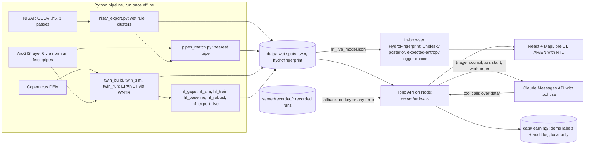

</details>

**Tech stack**

| Layer | Used |
|---|---|
| Frontend | Vite 7, React 18, TypeScript 5.9, MapLibre GL 5, self-hosted Inter and IBM Plex Sans Arabic, `qrcode` |
| Backend | Hono 4 on Node (`@hono/node-server`, run with `tsx`); typed JSON routes and server-sent events |
| AI | Claude Messages API with tool use (`@anthropic-ai/sdk`), default model `claude-opus-5-5`, with a recorded fallback; HydroFingerprint inference runs in the browser |
| Pipeline (offline) | Python: NumPy, SciPy, scikit-learn, WNTR/EPANET 2.2, rasterio, shapely, pyproj, h5py |

---

## FAQ and troubleshooting

<details>
<summary><b>I have no API key. Does it work?</b></summary>

Yes. Every AI screen (council, triage, work order, assistant) falls back to a **recorded run** from `server/recorded/`, tagged "Recorded run" with the reason. In Ask Missing Blue, the four suggested questions have recorded answers. A question you type yourself gets an honest "live AI unavailable" answer instead of an invented one.

</details>

<details>
<summary><b>I set a key, but it still says "Recorded run".</b></summary>

- Open <http://localhost:8787/api/health>. `"claude": true` means the server sees the key.
- `.env` is read with `process.loadEnvFile`. On Node older than 20.12 it is silently skipped, so update Node or export `ANTHROPIC_API_KEY` in your shell.
- Restart the server after you edit `.env`.
- Any live error (network, auth, timeout, refusal, a number that fails the check) falls back on purpose. The screen shows the reason.
- If your key is scoped to a workspace, also set `ANTHROPIC_WORKSPACE_ID`; without it the API answers 400.

</details>

<details>
<summary><b>Can I run it offline?</b></summary>

Yes. Everything is local except the online map tiles (satellite imagery, the OpenStreetMap "Map" style and the optional 3D terrain) and the live Claude calls. Offline, the map draws a plain dark ground under the pipes, spots and radar overlays. The AI screens show recorded runs, and the HydroFingerprint model runs in the browser. Build once while online (`npm install`, `npm run fetch:pipes`, `npm run demo`).

</details>

<details>
<summary><b>Port 8787 is already in use.</b></summary>

Set another port in `.env` (`PORT=8788`) or for one run:

```bash
PORT=8788 npm run demo
```

In PowerShell, use `$env:PORT=8788; npm run demo`. In `npm run dev`, the Vite proxy follows the same `PORT` from the shell.

</details>

<details>
<summary><b>The pipes are missing / "run npm run fetch:pipes".</b></summary>

The pipe network is not in git on purpose (see [held back](#data-and-honesty)). Run `npm run fetch:pipes`. It pages through ArcGIS layer 6 and writes `data/pipes/karak_pipes.geojson`. If ArcGIS answers with an error, the script stops with "ArcGIS answered HTTP …". Check `/api/health` for `"pipes": true`.

</details>

<details>
<summary><b>The map is blank or dark.</b></summary>

- A **dark ground with data on it** is the offline fallback. It appears when the browser is offline or after 3 tile errors. Try the **Satellite | Map** switch, or turn **3D** off.
- A **page that says "App not built"** means `dist/` is missing. Use `npm run demo`, which builds first.
- Pipes do not show? See the question above.

</details>

<details>
<summary><b>The Hydraulic twin or Map edits screen says "held back".</b></summary>

That is expected in a fresh clone. The twin and the HydroFingerprint live model contain pipe coordinates and are held back from the public repo. The screens explain this, and the committed robustness and scale results still render.

</details>

<details>
<summary><b>How do I switch to Arabic?</b></summary>

Click **العربية** in the sidebar footer (it reads **English** in Arabic mode). The whole layout flips to right to left, and the choice is remembered in this browser. Adding `?lang=ar` or `?lang=en` to a route overrides it, as in `#/crew/W7?lang=ar`; the crew QR code uses this.

</details>

<details>
<summary><b>The QR code does not open on my phone.</b></summary>

The phone must be on the same Wi-Fi as the laptop. The QR code uses the laptop's network address (`GET /api/workorder/lan`) because a phone cannot open `localhost`.

</details>

<details>
<summary><b>How do I reset the demo state?</b></summary>

| What | How |
|---|---|
| Crew reports and order status (this browser) | Open Demo mode, or go back to step 1, or click **Reset demo reports** on the work order |
| Adaptive learning labels | **Reset to the dispatch rule** on `#/learning` (`POST /api/learning/reset`, logged in the audit log) |
| Presenter clock | **Reset clock** in the demo bar (kept per tab) |
| Everything local | Stop the server and delete `data/learning/` (demo labels and audit log, gitignored) |

</details>

---

## Sources, licences and credits

| Dataset / claim | Source | Licence / status |
|---|---|---|
| NISAR L2 GCOV radar, track 151 frame 73, passes 4 / 16 / 28 Sep 2026 | [ASF notice](https://asf.alaska.edu/notices/nisar-l-band-data-now-publicly-available/) · [ASF search](https://search.asf.alaska.edu) | NASA open data, marked PROVISIONAL |
| Karak water network (layer 6, 8,779 records, 8,778 with geometry) | [ArcGIS item 7f8adf3ae966453f8cec976d9c35ef48](https://www.arcgis.com/home/item.html?id=7f8adf3ae966453f8cec976d9c35ef48) | Public, **no licence stated**; publisher "AJI Group" unconfirmed. Demo use only, not redistributed |
| Copernicus DEM GLO-30 | [AWS Open Data registry](https://registry.opendata.aws/copernicus-dem/) | Copernicus DEM licence, © DLR/Airbus provided under COPERNICUS |
| Rain 15 Aug–30 Sep 2026 (0.0 mm between passes) | [Open-Meteo historical weather API (ERA5)](https://open-meteo.com/en/docs/historical-weather-api) | CC BY 4.0 |
| Land cover at the spots, 2023–2025 | [Sentinel-2 10 m Land Use/Land Cover](https://ic.imagery1.arcgis.com/arcgis/rest/services/Sentinel2_10m_LandCover/ImageServer) | Impact Observatory / Microsoft / Esri, Living Atlas terms |
| Jordan non-revenue water 41% (Aug 2026), target 25% by 2040 | [Petra news agency](https://www.petra.gov.jo/en/news/water-loss-cut-to-41-exceeding-target) | Cited |
| Jordan non-revenue water ~50% (2020) | [National Water Strategy 2023–2040 summary](https://agwkp.unescwa.org/sites/default/files/2023-10/National_Water_Strategy_2023-2040_Summary-English_-ver2-%20Jordan.pdf) | Cited |
| Government AI leak project (Smart Transformation, sensor data) | [MENA Startup Digest](https://menastartupdigest.com/?p=47589) | Context |
| NISAR L-band 24 cm; 12-day repeat; GCOV 10/20 m posting (ours 20 m) | [NASA](https://science.nasa.gov/mission/nisar/) · [JPL](https://www.jpl.nasa.gov/press-kits/nisar/mission-overview) · [ASF GCOV docs](https://nisar-docs.asf.alaska.edu/gcov/) | Cited |
| EPANET (public domain), WNTR (EPA/Sandia) | [EPANET](https://www.epa.gov/water-research/epanet) · [WNTR](https://github.com/USEPA/WNTR) | Used offline to build the twin and the simulations |
| ASTERRA commercial L-band leak detection | [asterra.io](https://asterra.io/) | Context |
| Satellite basemap (default): Esri World Imagery | [ArcGIS item](https://www.arcgis.com/home/item.html?id=10df2279f9684e4a9f6a7f08febac2a9) · tiles `https://server.arcgisonline.com/ArcGIS/rest/services/World_Imagery/MapServer/tile/{z}/{y}/{x}` | Esri Master License Agreement; attribution "Esri, Vantor, Earthstar Geographics, and the GIS User Community"; non-commercial hackathon demo; online only, not cached. Capture date is not the radar date (27 May 2020 at W7, W3 and Karak Castle per Esri metadata, checked 10 Oct 2026) |
| Basemap labels: Esri World Transportation + World Boundaries and Places | [Roads item](https://www.arcgis.com/home/item.html?id=94f838a535334cf1aa061846514b77c7) · [Places item](https://www.arcgis.com/home/item.html?id=a842e359856a4365b1ddf8cc34fde079) | Esri Master License Agreement; attribution "Esri, HERE, Garmin, © OpenStreetMap contributors, and the GIS User Community"; online only |
| Optional 3D terrain: AWS Terrain Tiles (Terrarium) | [AWS Open Data registry](https://registry.opendata.aws/terrain-tiles/) · tiles `https://s3.amazonaws.com/elevation-tiles-prod/terrarium/{z}/{x}/{y}.png` | Open data (Mapzen); attribution required for its sources ([list](https://github.com/tilezen/joerd/blob/master/docs/attribution.md)), e.g. SRTM and GMTED2010 (USGS), ETOPO1 (NOAA); online only |
| "Map" basemap | © OpenStreetMap contributors | ODbL (online only) |

Full list with verification notes: [SOURCES.md](SOURCES.md). Data dictionary and verified facts: [CLAUDE.md](CLAUDE.md). The pitch script is in [PITCH_7MIN.md](PITCH_7MIN.md) and the user journeys are in [USER_JOURNEY.md](USER_JOURNEY.md).

**Credits.** Built by [kurdim12](https://github.com/kurdim12) for AI Quest 2026. Data comes from NASA/ISRO (NISAR, via ASF DAAC), the Karak water network published on ArcGIS (AJI Group item), Copernicus, Open-Meteo (ERA5), Impact Observatory / Microsoft / Esri, Esri basemaps, Mapzen / AWS Terrain Tiles and OpenStreetMap contributors.

**Licence.** This repository has no `LICENSE` file, so no licence is stated for the code. Each dataset keeps its own terms (table above). The pipe network has no stated licence and is not redistributed here.
